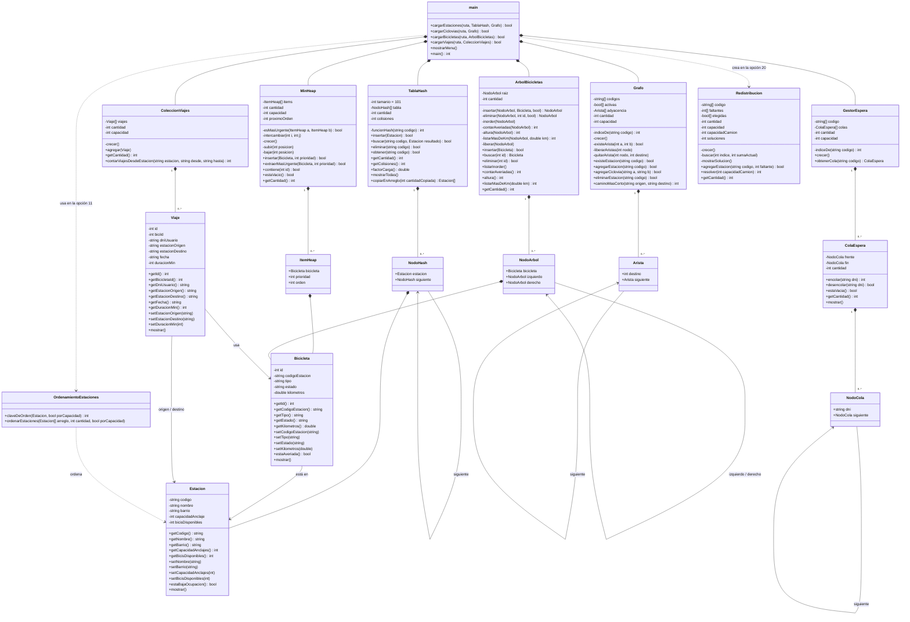

# Diagrama de clases UML — Sistema de Bicicletas Públicas

Trabajo Práctico de Algoritmos — UNAHUR (grupo 6)

> El diagrama está escrito en [Mermaid](https://mermaid.js.org/), que GitHub renderiza automáticamente en archivos `.md`.
> Para verlo como imagen también se puede pegar el bloque en <https://mermaid.live>.

## Convenciones

| Símbolo | Significado |
|---|---|
| `A *-- B` | **Composición**: A contiene a B y lo crea y destruye (B no existe sin A) |
| `A --> B` | **Asociación**: A conoce o referencia a B, pero no es su dueño |
| `A ..> B` | **Dependencia**: A usa a B de forma puntual (por ejemplo, dentro de un método) |
| `+` / `-` | Miembro público / privado |
| `Tipo[]` | Arreglo dinámico o puntero a arreglo (`Tipo*` en el código) |

## Diagrama completo

## Resumen de relaciones

### Composición

| Todo | Parte | Por qué |
|---|---|---|
| `main` | `TablaHash`, `MinHeap`, `Grafo`, `ArbolBicicletas`, `GestorEspera`, `ColeccionViajes` | `main` crea las estructuras y vive mientras corre el programa |
| `TablaHash` | `NodoHash` | Cada posición de la tabla tiene una lista enlazada de nodos |
| `NodoHash` | `Estacion` | El nodo guarda la estación por valor |
| `MinHeap` | `ItemHeap` | El arreglo del heap está formado por ítems |
| `ItemHeap` | `Bicicleta` | El ítem guarda la bicicleta con su prioridad |
| `Grafo` | `Arista` | Lista de adyacencia: cada nodo tiene una lista de aristas |
| `ArbolBicicletas` | `NodoArbol` | El árbol es un conjunto de nodos enlazados |
| `NodoArbol` | `Bicicleta` | Cada nodo guarda una bicicleta |
| `GestorEspera` | `ColaEspera` | Una cola por estación |
| `ColaEspera` | `NodoCola` | La cola es una lista enlazada |
| `ColeccionViajes` | `Viaje` | Arreglo dinámico de viajes |

### Asociación

| Origen | Destino | Significado |
|---|---|---|
| `NodoHash`, `Arista`, `NodoCola` | sí mismos (`siguiente`) | Enlace al próximo nodo de la lista |
| `NodoArbol` | `NodoArbol` | Hijo izquierdo y derecho |
| `Bicicleta` | `Estacion` | Referencia a la estación por `codigoEstacion` |
| `Viaje` | `Bicicleta` | Referencia a la bici por `biciId` |
| `Viaje` | `Estacion` | Referencia a origen y destino por código |

### Dependencia

| Origen | Destino | Significado |
|---|---|---|
| `main` | `Redistribucion` | Se instancia localmente al elegir la opción 20 del menú |
| `main` | `OrdenamientoEstaciones` | Se usa para listar estaciones ordenadas (opción 11) |
| `OrdenamientoEstaciones` | `Estacion` | Ordena un arreglo de estaciones |

## Notas sobre el diagrama

- La clase del heap se llama `MinHeap` en el código (en la imagen original figuraba como `MiniHeap`).
- El diagrama original no tenía relaciones entre clases fuera de `main`; se agregaron las composiciones y asociaciones que pide el enunciado.
- Los métodos privados auxiliares (`crecer`, `subir`, `bajar`, etc.) se mantienen del diagrama original. Si el código cambia, conviene actualizar este archivo.